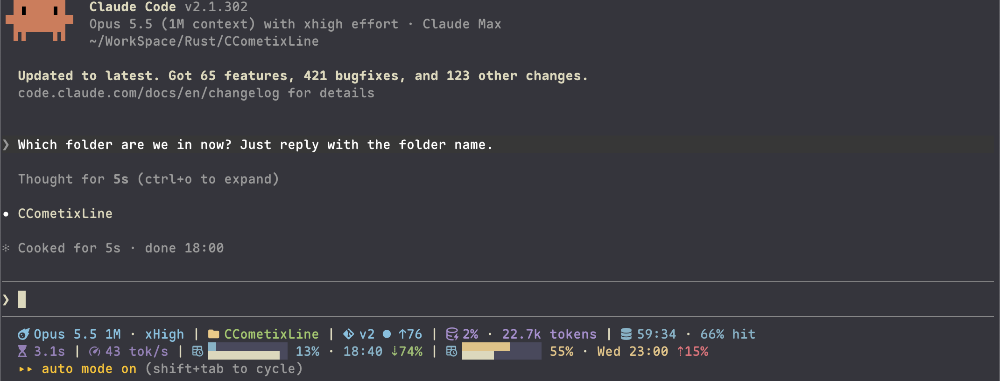
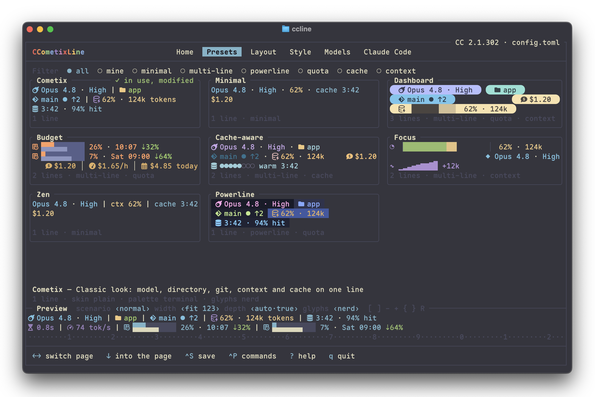
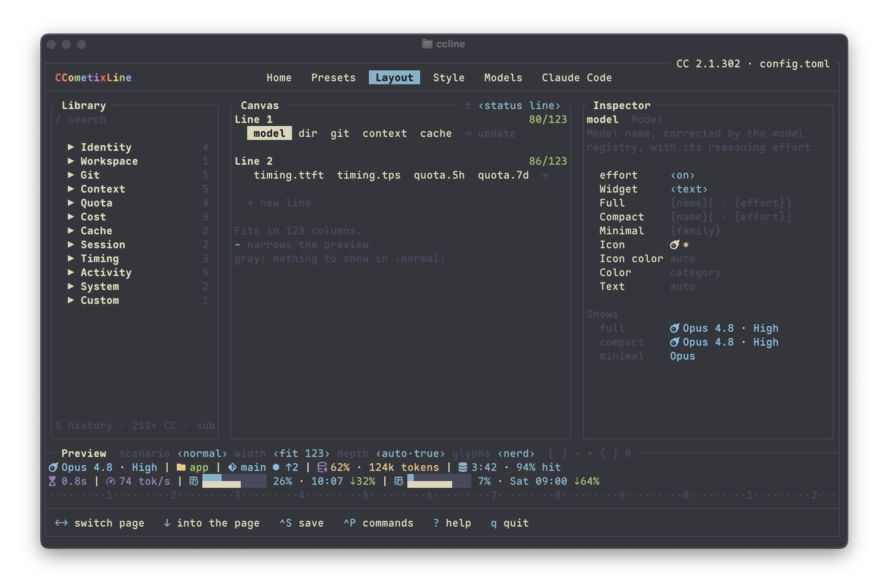
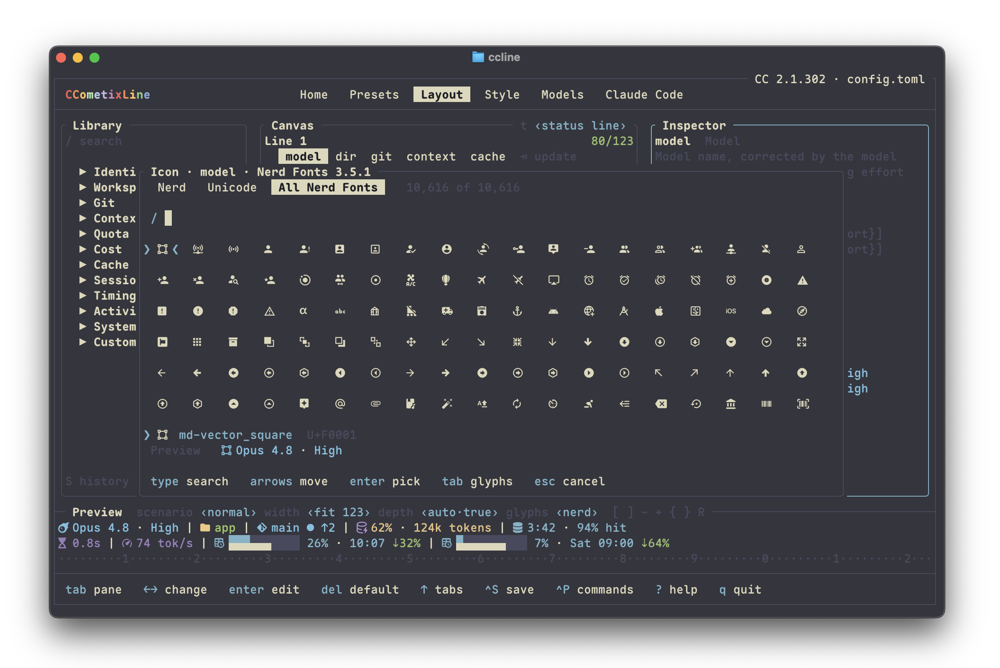

# CCometixLine

[English](README.md) | [中文](README.zh.md)

用 Rust 编写的 Claude Code 状态栏：渲染快、可自由组合，自带全屏配置器。




## 亮点

- **会话状态一眼可见**：模型与推理强度、目录、git、上下文占用、提示缓存的剩余时间与命中率、5 小时与每周额度（以及用量比时间快还是慢）、费用、PR 等，共 30 多项指标。
- **任意指标、任意形态**：每一项都可以显示成文字、进度条、分档图标、曲线或配速条，并备有三档文字模板，宽度不够时逐档缩短。
- **自适应宽度**：终端变窄时在条目之间换行；右侧一组始终贴右对齐。
- **外观**：四种骨架（plain、bracket、pill、powerline），13 套调色板（可以跟随终端配色，也可以自带颜色），Nerd Font / Unicode / ASCII 三档字形，色深从真彩到无色。
- **八个预置**开箱即用，自己保存的预置和它们放在一起。
- **配置器**：所有设置都能编辑，用示例会话实时预览，还能替你把 Claude Code 接到 ccline。
- **第三方模型也准确**：模型登记表校正 Claude Code 不认识的模型名和上下文窗口。
- **后台任务**：同一个程序也负责绘制每个运行中子代理下面的那一行。
- **轻量**：一次渲染只比进程启动多几毫秒；git 在后台运行，不占渲染时间。

## 安装

```bash
npm install -g @cometix/ccline
```

<details>
<summary>yarn、pnpm、npm 镜像</summary>

```bash
yarn global add @cometix/ccline
pnpm add -g @cometix/ccline
npm install -g @cometix/ccline --registry https://registry.npmmirror.com
```

</details>

安装后程序位于 `~/.claude/ccline/ccline`，同时提供全局命令 `ccline`。以后更新：`npm update -g @cometix/ccline`。

<details>
<summary>手动下载</summary>

从 [Releases](https://github.com/Haleclipse/CCometixLine/releases) 下载对应平台的压缩包，把程序放到 `~/.claude/ccline/ccline`（Windows 为 `ccline.exe`）。

| 平台 | 压缩包 |
|---|---|
| Linux x64（glibc 2.35+） | `ccline-linux-x64.tar.gz` |
| Linux x64 静态链接 | `ccline-linux-x64-static.tar.gz` |
| Linux arm64 | `ccline-linux-arm64.tar.gz` |
| Linux arm64 静态链接 | `ccline-linux-arm64-static.tar.gz` |
| macOS Intel | `ccline-macos-x64.tar.gz` |
| macOS Apple Silicon | `ccline-macos-arm64.tar.gz` |
| Windows x64 | `ccline-windows-x64.zip` |

```bash
mkdir -p ~/.claude/ccline
tar -xzf ccline-macos-arm64.tar.gz
mv ccline ~/.claude/ccline/ && chmod +x ~/.claude/ccline/ccline
```

</details>

<details>
<summary>从源码构建</summary>

```bash
git clone https://github.com/Haleclipse/CCometixLine.git
cd CCometixLine
cargo build --release
mkdir -p ~/.claude/ccline
cp target/release/ccometixline ~/.claude/ccline/ccline
```

</details>

## 接入 Claude Code

在终端里运行 `ccline`。首次运行会带你检查字体、选一个预置，并把 Claude Code 接到 ccline；**Claude Code** 页在写入 `settings.json` 之前会先列出改动，并保留备份。

也可以自己编辑 `~/.claude/settings.json`：

```json
{
  "statusLine": {
    "type": "command",
    "command": "~/.claude/ccline/ccline",
    "padding": 0
  },
  "subagentStatusLine": {
    "type": "command",
    "command": "~/.claude/ccline/ccline"
  }
}
```

`subagentStatusLine` 可选，用来在每个后台任务下面绘制 ccline 的任务行。Windows 上同样可以用 `~`（Claude Code 2.1.47+）；如果是 npm 全局安装，也可以写 `"command": "ccline"`。

## 预置



| 预置 | 行数 | 外观 | 内容 |
|---|---|---|---|
| `cometix`（默认） | 1 | plain，终端配色 | 经典样式：模型、目录、git、上下文、缓存 |
| `minimal` | 1 | plain，无图标 | 模型、上下文、缓存、费用 |
| `dashboard` | 3 | pill，Catppuccin Mocha | 身份与 git；上下文、趋势、5 小时配速、缓存；代码改动 |
| `budget` | 2 | plain，Tokyo Night | 5 小时与每周额度的配速和预计用完时间、花费速率；上下文、距自动压缩、缓存 |
| `cache-aware` | 2 | plain，Rosé Pine | 常规一行；缓存倒计时条、命中率、未命中次数与原因 |
| `focus` | 2 | plain，Unicode | 宽幅上下文条、每轮增量、距自动压缩、缓存 |
| `zen` | 1 | ASCII，无色 | 任何终端都能用 |
| `powerline` | 1 | powerline，Tokyo Night | powerline 段，带 5 小时额度图标 |

在配置器里可以应用整个预置，也可以只应用它的布局或只应用外观。在 Presets 页按 `N` 可以把当前设置另存为自己的预置，文件保存在 `~/.claude/ccline/presets/`。

## 配置器

运行 `ccline`（或 `ccline -c`）。共六页，用 `1`–`6` 切换；任何改动都会立刻显示在预览栏里，预览和真实状态栏用的是同一套渲染代码。

| 页面 | 作用 |
|---|---|
| 1 Home | 检查你的环境（Claude Code 版本、状态栏设置、`config.toml`、`models.toml`、更新），每个问题都配了修复按键；并用你最近一次真实会话显示状态栏 |
| 2 Presets | 预置画廊，每张卡片都是实时渲染的 |
| 3 Layout | 从指标库挑选指标，安排到各行和左右两侧，再细调选中的条目：形态、进度条字形与格数、文字模板、图标、颜色、阈值 |
| 4 Style | 骨架、调色板、字形、色深、填充方式，以及在调色板之上的颜色覆盖 |
| 5 Models | 模型登记表：最近会话里没认出的模型 id、你的规则及命中次数、解析测试器 |
| 6 Claude Code | `statusLine`、`subagentStatusLine`、`refreshInterval`、更新检查、配套 mod |



图标选择器收录了 Nerd Fonts 3.5.1 的全部 10,617 个图标，可以按名称、类前缀（`md-`、`fa-`、`cod-` …）、码位搜索，也可以直接粘贴图标。



全局按键：`^S` 保存，`^Z` / `^Y` 撤销与重做，`^P` 命令面板，`[` `]` 切换示例会话，`-` `+` 调整预览宽度，`{` 色深，`}` 字形，`?` 帮助，`q` 退出。

## 指标

| 类目 | 指标 |
|---|---|
| 身份 | `model`（含推理强度）、`output_style`、`vim`、`agent` |
| 会话 | `session_name`、`duration` |
| 上下文 | `context`、`context.trend`、`context.to_compact`、`context.breakdown`¹ |
| 额度 | `quota.5h`、`quota.7d`、`quota.spend`、`quota.eta` |
| 费用 | `cost`、`cost.rate`（每小时）、`cost.today`（所有会话） |
| 缓存 | `cache`（距变冷的时间、命中率、未命中）、`cache.cold_cost` |
| 代码 | `dir`、`git`、`repo`、`pr`、`worktree`、`lines` |
| 活动与计时 | `activity.tools`¹、`activity.agents`¹、`timing.ttft`¹、`timing.tps`¹ |
| 系统 | `cc_version`、`update` |
| 自定义 | `cmd`：任意 shell 命令输出的第一行，带缓存，在后台运行 |

¹ 需要配套 mod 和 Claude Code 2.1.287+。`cache` 与 `quota.spend` 需要 Claude Code 2.1.251+。配置器会标出你当前的 Claude Code 显示不了的指标，并且不允许添加。

条目只在有内容时才显示：Claude Code 报告了缓存才显示缓存，有新版本才显示 `update`，`output_style` 是默认风格时不显示。

`quota.5h` 和 `quota.7d` 默认画成两行的配速条：上面一行是已用额度，下面一行是窗口时间过去了多少。`⇡8%` 表示用量比时间快 8 个百分点，`⇣` 表示比时间慢，`±0%` 表示持平。

后台任务行有自己的指标：`task.label`、`task.name`、`task.status`、`task.elapsed`、`task.trend`，也可以使用 `model`、`context` 等会话指标。

## 配置

所有文件都在 `~/.claude/ccline/`（可用 `CCLINE_HOME` 改位置）。配置器写的是 `config.toml`，也可以手动编辑：

```toml
preset  = "cometix"
palette = "terminal"
skin    = "plain"
glyphs  = "nerd"
separator = " | "

[[line]]
left = [
  "model",
  { metric = "dir", icon_color = "bright_yellow" },
  "git",
  { metric = "context", widget = "text", format = "{pct}%[ · {tokens} tokens]" },
  "cache",
]
right = ["update"]

[[line]]
left = [{ metric = "quota.5h", cells = 10 }, { metric = "quota.7d", cells = 10 }]
right = [{ metric = "cmd", options = { run = "kubectl config current-context", cache_s = 30 } }]
```

每个 `[[line]]` 分 `left` 和 `right` 两组，右组贴右对齐。条目可以直接写指标 id，也可以写成表：

| 键 | 含义 |
|---|---|
| `metric` | 指标 id |
| `widget` | `text`、`bar`、`gauge`、`sparkline` 或 `pace` |
| `bar`、`cells` | 进度条字形（`blocks`、`eighths`、`shapes`、`dots`、`braille`、`ascii`）和格数 |
| `format`、`compact`、`minimal` | 三档文字模板：`{字段}` 插入数值，`[ … ]` 里只要有字段为空，整组就不显示 |
| `icon` | 覆盖图标；`""` 表示不要图标 |
| `color`、`fg`、`icon_color` | 调色板 token（`accent`、`warn`、`cache` …）、颜色名（`bright_yellow`）、`#rrggbb`、`256:n` 或 `16:n` |
| `levels`、`coloring` | 警告阈值，如 `[[50, "warn"], [80, "crit"]]`；`steps`（整段变色）或 `gradient`（逐格渐变） |
| `options` | 指标选项，例如 `dir` 的 `style`、`cmd` 的 `run` |

调色板：`terminal`（跟随终端主题）、`catppuccin-mocha`、`catppuccin-latte`、`dracula`、`nord`、`tokyo-night`、`rose-pine`、`gruvbox`、`anthropic-clay`，以及沿用 v1 powerline 配色的 `powerline-dark`、`powerline-light`、`powerline-rose-pine`、`powerline-tokyo-night`。自定义调色板放在 `palettes/*.toml`；`[palette_overrides]` 可以单独改某个 token。

配置文件解析失败时状态栏不会空白：ccline 会用默认预置绘制，并在行尾加上 `! config`。

### 第三方模型

Claude Code 对不认识的模型一律按 200k 窗口计算，所以第三方模型的上下文百分比可能不对。在 `models.toml` 里可以设置正确的名称和窗口：

```toml
[[models]]
pattern = "kimi-k2"
display_name = "Kimi K2"
context_limit = 256000
match = "contains"          # contains、prefix、exact 或 regex

[[context_modifiers]]
pattern = "[1m]"
display_suffix = " 1M"
context_limit = 1000000
```

Models 页会列出最近出现过、但没有规则能认出的模型 id，按一个键就能为它新建规则。

## 配套 mod

在 Claude Code 2.1.287+ 上，可以安装一个可选的 mod，把状态栏输入里没有的数据传给 ccline：首 token 延迟、输出速度、正在运行的工具和代理、上下文的构成，以及准确的自动压缩点。mod 本身不绘制任何界面。

```bash
ccline mod install     # 也可以在 Claude Code 页安装
ccline mod status
ccline mod uninstall
```

要让这些数值实时刷新，需要 Claude Code 定时重绘状态栏：在 Claude Code 页把 `refreshInterval` 设为 2 秒。

## 命令

| 命令 | 说明 |
|---|---|
| `ccline` | 在终端里运行时打开配置器；Claude Code 通过管道传入会话数据时绘制状态栏 |
| `ccline preview` | 用内置示例会话渲染你的配置（`--all`、`-s <名称或 JSON 文件>`、`--subagent`、`--list`） |
| `ccline update` | 立即检查新版本。ccline 平时每天在后台检查一次，有新版本时显示 `update`；它从不自行下载 |
| `ccline mod` | 安装、更新或移除配套 mod |

## 环境要求

- Claude Code 2.1.153 或更新；部分指标需要更新的版本，见上文。
- 显示图标、powerline 和 pill 需要 [Nerd Font](https://www.nerdfonts.com/)。没有的话可以用 `unicode` 或 `ascii` 字形，配置器的字体检查会帮你选择。
- `git` 指标需要安装 Git。

## 从 v1 升级

v2 是重写版，配置格式全新，不读取 v1 的 `config.toml` 和主题。在配置器里选一个预置开始即可；默认的 `cometix` 保留了 v1 的样子。`models.toml` 原样沿用。`--theme` 和 Claude Code 补丁功能已移除。

## 开发

```bash
cargo build
cargo test             # 单元测试，以及每个预置在每个示例会话下的快照
cargo build --release
```

## 相关项目

- [tweakcc](https://github.com/Piebald-AI/tweakcc)：自定义 Claude Code 的主题、思考动词等。

## 许可证

[MIT](LICENSE)

## Star History

[](https://star-history.com/#Haleclipse/CCometixLine&Date)
